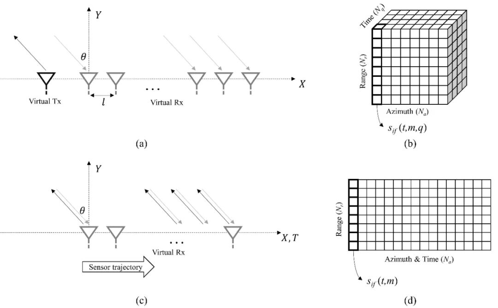
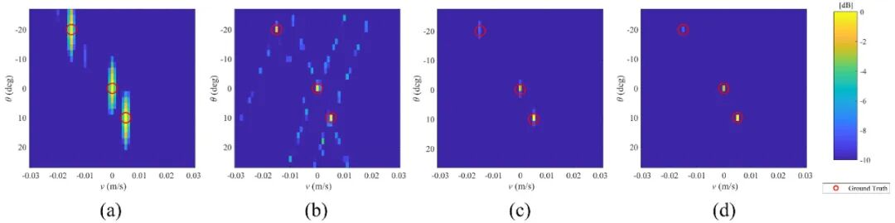
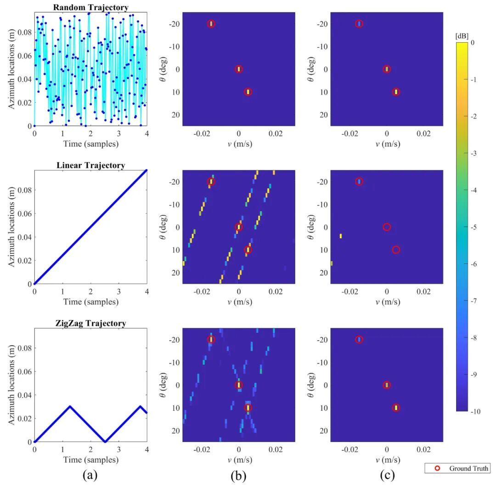
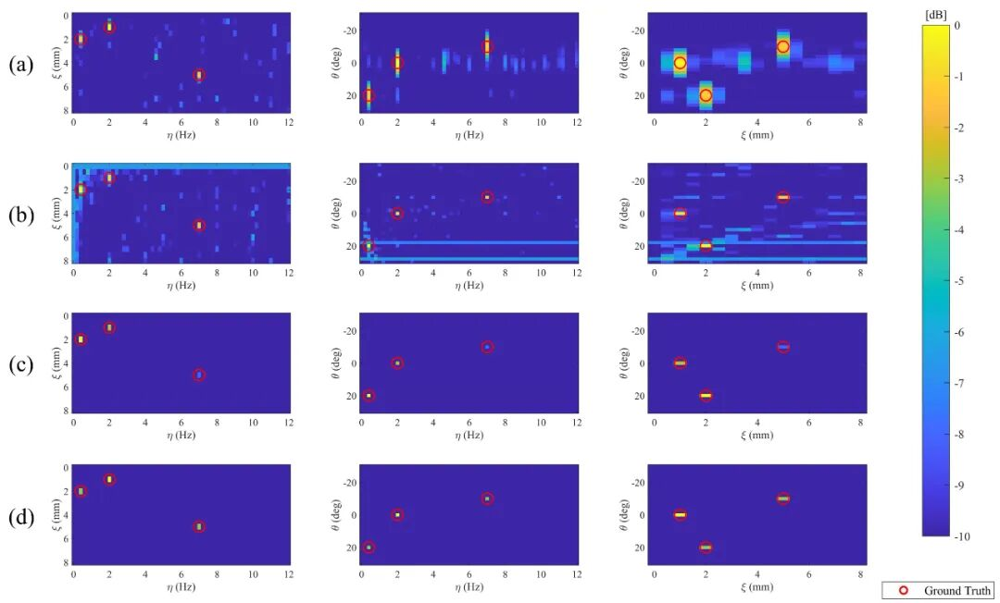
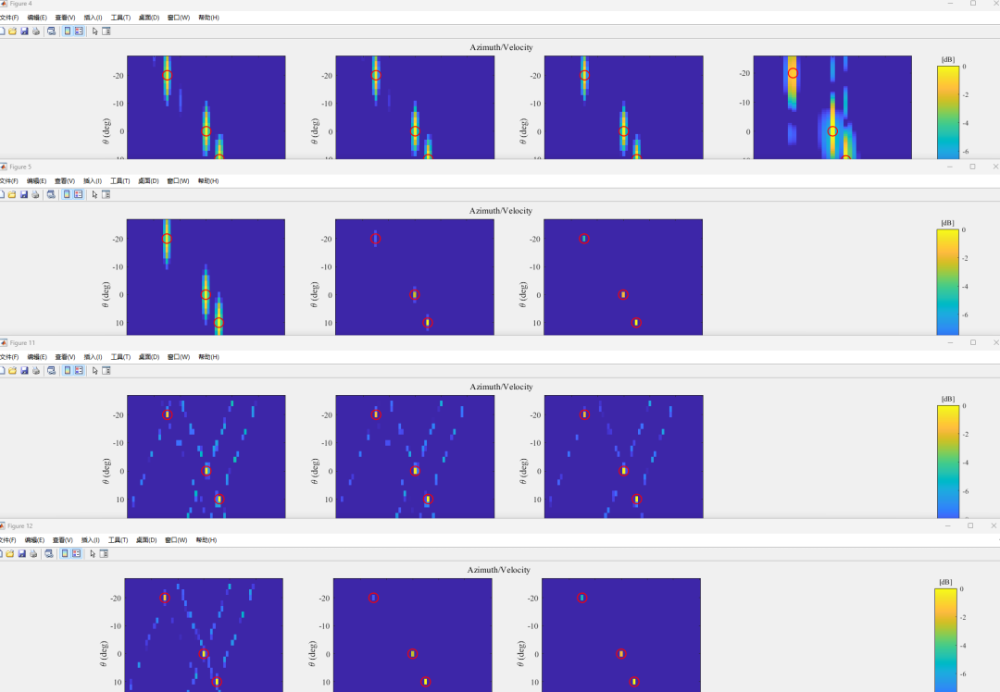

# Ground-Based Radar (GBSAR) System Online Displacement and Vibration Monitoring Spectral Estimation Model [Includes MATLAB Code, with two debugging errors needed, Simulation Results to Run]

Introduction 
Research and experiments on radar interferometry have been conducted, and its application in radar remote sensing has become widespread. Satellite-based technology enables the monitoring of target displacement with sub-millimeter accuracy [1-3]. Multi-baseline and/or time-series synthetic aperture radar (SAR) provide cross-track resolution by processing radar signals for interference at different horizontal range positions [4]. Therefore, radar interferometry is fundamental to multidimensional radar imaging and displacement monitoring. Spaceborne Synthetic Aperture Radar Interferometry (InSAR) is a mature technique for large-scale Earth environmental monitoring, while Ground-Based Interferometry (ESAR) is an emerging remote sensing technology with a wide range of applications. (or ground-based) Radar Interferometry (TRI), Ground-Based SAR (GBSAR) Interferometry (GBInSAR), and recent ground MIMO radars primarily belong to non-contact systems for monitoring dynamic areas with good temporal resolution and lower atmospheric influence than satellite data [5-7].
The GBSAR system typically achieves horizontal resolution through the movement of a radar sensor along a specified trajectory on a mechanical track [8]. The MIMO system, as a well-known ground data acquisition method, can increase the data collection interval to fractions of a second by using an additional number of physical antennas [9, 10]. In this context, MELISSA [11] is the first ground-based MIMO system, comprising 12 transmitters and 12 receiveant antennas for geophysical and structural displacement monitoring [12]. Recent studies have also demonstrated the effectiveness of automotive 77 GHz W-band MIMO radars for structural monitoring [13-15]. Indeed, higher operating frequencies make systems more compact and lighter, simplifying deployment [9]. These systems are suitable for monitoring individual objects, such as buildings, bridges, or wind turbines [16-18]. However, in practice, issues such as signal interference, high sidelobes, and Signal-to-Noise Ratio (SNR) must be addressed to obtain accurate results from GBSAR or MIMO radar data for target focusing and displacement estimation.
Spectral estimation (SE) technology has shown tremendous potential in processing SAR data to detect interesting signals [17, 19, 20]. Generally, SE aims to estimate the power spectrum of a signal. The Fast Fourier Transform (FFT) is the most simple but most popular SE technique. These methods have produced interesting results in estimating the parameters of interest from observed signals, even with low Signal-to-Noise Ratio (SNR) [19, 21]. In recent years, SE methods have evolved to address multidimensional SAR problems. Compared to traditional displacement mapping using time-series SAR data and based on the Persistent Scatterer Interference (PSI) technique, which only processes phase information while ignoring the amplitude of the signal [21-24], SE methods utilize the complete information of SAR data superimposed by radar or SAR signals (both phase and amplitude) to separate the position and displacement characteristics of multiple scattering targets [25]. Particularly, SE techniques have been widely used in SAR tomography (TomoSAR), for retrieving 3D reflectivity of natural or urban targets using multi-baseline SAR data, such as urban height reconstruction [26], or volume targets like forest biomass [27] and ice thickness [28]. SE methods also show great potential in multidimensional monitoring of urban areas, for example, in the linear displacement velocity of structures and the 4D and 5D differential TomoSAR reconstruction of thermal expansion [21, 29, 30].
The real-aperture radar (RAR) can provide high data acquisition frequencies within the kilohertz range. Consequently, recent studies have demonstrated the performance of RAR as a non-contact system for monitoring rapid displacement or vibrations [31, 32]. One of the main challenges in GBSAR imaging compared to RAR is the relatively long data collection interval, typically spanning several minutes. This limitation hinders its application for real-time and rapid displacement monitoring, such as structural vibration monitoring [33]. Additionally, mechanical fluctuations during radar movement may potentially affect the desired consistent azimuth sampling in GBSAR imaging. This could introduce noise into the collected data, further complicating the imaging process [34]. Although MIMO technology significantly addresses these issues, this imaging mode requires a significant number of physical antennas to achieve comparable horizontal resolution with GBSAR. This requirement leads to significant increases in system size and cost. Moreover, due to antenna interference and the presence of multiple scattering bodies within an interval, the obtained data may include strong sidelobes, further complicating the imaging process [35]. This paper proposes a monitoring system that utilizes signals collected from ground radar and SE methods to achieve high-resolution results. The main focus of this paper is on developing a model that estimates linear and nonlinear displacements of scatterers while acquiring data through radar signals. The model employs various spectral estimation techniques and takes into account data obtained from GBSAR and MIMO radar configuration modes. The model includes detecting linear velocity, amplitude, and frequency-dependent nonlinear vibration displacements, as well as detecting target positions in azimuth angle. By adopting this framework, the system provides multidimensional imaging capabilities while suppressing sidelobes and achieving high signal-to-noise ratio (SNR). Furthermore, it addresses a key limitation of the GBSAR system, enabling rapid and real-time displacement detection during data collection. Finally, the main contributions of this paper are summarized as follows:
· Proposed a linear and vibrational displacement monitoring model based on GBSAR imaging and spectral estimation methods: This method improves the spatial localization of deformation areas detected on the monitored object.
· Proposed a linear and vibration displacement monitoring model based on ground-based MIMO radar imaging and spectral estimation methods: This method enhances the signal-to-noise ratio of the focused signals, therefore .
· Simulation and real experiments to evaluate the proposed framework .
· Analyses of various performance evaluations of MIMO radar and SAR imaging modes.
Article illustration
MATLAB simulation results

## Images

<!-- PAYMENT_BLOCK -->

## Get this dataset

- Payment link (Stripe): [Buy now](https://buy.stripe.com/3cs8yP7sY87d0vu9AB)
- Payment QR code: 

<!-- /PAYMENT_BLOCK -->
